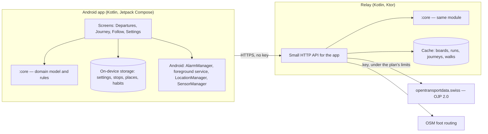

# Target architecture (Android MVP)

> Status: **accepted** by the PO on 20.11.2026 ([TECH-13](https://github.com/TiagSant/swissPublicTransport/issues/172)): native Kotlin app, relay in Kotlin/Ktor hosted at Infomaniak, MapLibre maps, licence GPL-3.0-or-later. See the [decision records](decisions/).

## Modules

| Module | Role | Notes |
|---|---|---|
| `android/app` | UI (Compose), navigation, Android services (alarms, following, sensors, location), storage. | No Google dependency (ADR-0003). |
| `android/core` | Pure Kotlin (JVM), no dependency: domain model (stop, line, departure, journey, ride, walk, wait, place, traffic message), Swiss time, habit scores, OJP 2.0 requests, parser and client; later the journey rules (priorities, de-duplication, change places, alarms). | Shared by the app and the relay. Unit-tested on the JVM with the recorded OJP answers, and checked against the prototype's own adapter (`tests/fixtures/ojp-kotlin`). |
| `relay/` | Holds the OJP key, caches answers, keeps requests under the key's limits, computes change places and returns journeys already improved. | ADR-0002. Its code lives in this repository so the network part is FLOSS (F-Droid). |
| `assets/` | Shared static data: line colours, platform positions (ATLAS), SBB pictograms. | Rebuilt by the existing workflows; bundled into the app at build time. |
| `prototype/` | The web prototype, frozen: the functional reference. | ADR-0005. |

## Data flow

1. **Departures**: app → relay `GET /stops/{id}/departures` → relay cache (≈ 20–30 s per stop) → OJP `StopEventRequest`. Run patterns (next stops) cached for a day.
2. **Journeys**: app → relay `POST /journeys` → OJP `TripRequest` + boards and runs needed for the change places → `:core` rules → improved journeys back to the app.
3. **Following**: the app polls the relay every 60 s while a journey is followed (foreground service); alarms are scheduled on the phone with `AlarmManager.setAlarmClock()` and moved when the data changes.
4. **Habits, places, settings, positions** stay on the phone. The relay receives only what a request needs (stop ids, coordinates of the start and end of a search) and keeps no history per rider.

## Technical baseline

| Topic | Choice |
|---|---|
| Language / UI | Kotlin, Jetpack Compose, Material 3 |
| Min / target SDK | 26 (Android 8.0) / 37 |
| Storage | DataStore (settings) and Room (stops, places, habits) |
| Network | `HttpURLConnection` in `:core` (no dependency; the relay may use Ktor's client); XML parsing in `:core` with the platform's DOM |
| Maps | MapLibre Native Android, OSM-based tiles from a provider allowing app use (ADR-0004) |
| Location / motion | `LocationManager` (GPS, network), `SensorManager` (accelerometer, step detector) |
| Alarms | `AlarmManager.setAlarmClock()`, full-screen intent, alarm audio channel, `BOOT_COMPLETED` |
| Build / CI | Gradle 9.6 (Kotlin DSL, version catalog), AGP 9.4; GitHub Actions `android.yml`: debug APK, unit tests, lint, refusal of Google libraries (ADR-0003) |
| Relay | Ktor (JVM), in-memory cache (+ optional disk), Docker image |
