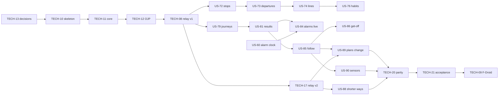

# Roadmap — Android MVP

One-week sprints, about 20 points each (see [workflow](../process/workflow.md)). Items are listed in priority order inside each sprint. The live backlog is in [GitHub Issues](https://github.com/TiagSant/swissPublicTransport/issues), one [milestone](https://github.com/TiagSant/swissPublicTransport/milestones) per sprint; this page is the plan as agreed at the start and is updated at each sprint review.

**Priorities:** P0 MVP blocker · P1 needed for parity with the prototype · P2 after the MVP · P3 idea. **Points:** Fibonacci (1–13).

## Overview

| Sprint | Dates | Goal | Points | Ships |
|---|---|---|---|---|
| 10 — Foundations | 23.11 – 27.11.2026 | Android project, shared core and OJP client in place; open decisions taken by the PO. | 19 | — |
| 11 — Relay and app shell | 30.11 – 04.12.2026 | The relay serves OJP data without a key on the phone; the app has its look, languages and storage. | 22 | Relay v1 online |
| 12 — Departures | 07.12 – 11.12.2026 | First APK: find a stop and see its departures, as in the prototype. | 21 | APK v0.12 (departures) |
| 13 — Habits, platforms, journey planning | 14.12 – 18.12.2026 | Usual lines preselected, platforms on a map, journeys searched from anywhere. | 21 | APK v0.13 |
| 14 — Journey results and my places | 21.12 – 25.12.2026 | Journey cards and details as in the prototype; Home, Work and places in one tap; audit of bus platforms in OSM. | 24 | APK v0.14 |
| 15 — Alarms | 28.12 – 01.01.2027 | Get-ready and leave alarms that ring like the alarm clock and follow live data. | 18 | APK v0.15 |
| 16 — Following a journey | 04.01 – 08.01.2027 | A journey followed live with the screen off; reminder before getting off. | 18 | APK v0.16 |
| 17 — Smarter changes | 11.01 – 15.01.2027 | The relay computes the best change places; the app shows the shorter ways. | 18 | APK v0.17, relay v2 |
| 18 — When plans change | 18.01 – 22.01.2027 | Missed or tight changes, cancellations, late starts; sensors and GPS only when it helps. | 18 | APK v0.18 |
| 19 — Trip parts, traffic, privacy | 25.01 – 29.01.2027 | Stopovers, round trips, traffic messages; permissions explained; Lausanne checked. | 17 | APK v0.19 (release candidate) |
| 20 — MVP release | 01.02 – 05.02.2027 | Parity with the prototype checked, PO field test, v1.0.0 on GitHub and submitted to F-Droid. | 16 | **v1.0.0**, F-Droid submission |

MVP total: **212 points** over 11 sprints. The weeks of 21.12 and 28.12 depend on the PO's availability for the reviews; a sprint can move by a week without changing the order.

## Sprint 10 — Foundations (23.11 – 27.11)

Goal: Android project, shared core and OJP client in place; open decisions taken by the PO.

| Item | Title | Priority | Points |
|---|---|---|---|
| [TECH-13](https://github.com/TiagSant/swissPublicTransport/issues/172) | PO decisions: licence, application ID, relay hosting, architecture | P0 | 1 |
| [TECH-10](https://github.com/TiagSant/swissPublicTransport/issues/169) | Android project skeleton and CI | P0 | 5 |
| [TECH-11](https://github.com/TiagSant/swissPublicTransport/issues/170) | Shared core: domain model and time handling | P0 | 5 |
| [TECH-12](https://github.com/TiagSant/swissPublicTransport/issues/171) | OJP 2.0 client in the shared core | P0 | 8 |
| | **Total** | | **19** |

## Sprint 11 — Relay and app shell (30.11 – 04.12)

Goal: The relay serves OJP data without a key on the phone; the app has its look, languages and storage.

| Item | Title | Priority | Points |
|---|---|---|---|
| [TECH-08](https://github.com/TiagSant/swissPublicTransport/issues/41) | Relay holding the OJP key before the APK is distributed | P0 | 8 |
| [TECH-14](https://github.com/TiagSant/swissPublicTransport/issues/173) | On-device storage: settings, stops, places, habits | P0 | 3 |
| [US-70](https://github.com/TiagSant/swissPublicTransport/issues/174) | Lines look like on the street: colours and pictograms | P0 | 5 |
| [US-71](https://github.com/TiagSant/swissPublicTransport/issues/175) | The app in my phone's language | P0 | 3 |
| [TECH-15](https://github.com/TiagSant/swissPublicTransport/issues/176) | Test harness: unit, UI and replay of prototype scenarios | P0 | 3 |
| | **Total** | | **22** |

## Sprint 12 — Departures (07.12 – 11.12)

Goal: First APK: find a stop and see its departures, as in the prototype.

| Item | Title | Priority | Points |
|---|---|---|---|
| [US-72](https://github.com/TiagSant/swissPublicTransport/issues/177) | Find a stop by name or near me, across Switzerland | P0 | 5 |
| [US-73](https://github.com/TiagSant/swissPublicTransport/issues/178) | Real-time departures at a stop | P0 | 5 |
| [US-74](https://github.com/TiagSant/swissPublicTransport/issues/179) | Choose the lines and directions shown | P0 | 5 |
| [US-75](https://github.com/TiagSant/swissPublicTransport/issues/180) | My stops one tap away | P0 | 3 |
| [TECH-03](https://github.com/TiagSant/swissPublicTransport/issues/12) | APK packaging | P0 | 3 |
| | **Total** | | **21** |

## Sprint 13 — Habits, platforms, journey planning (14.12 – 18.12)

Goal: Usual lines preselected, platforms on a map, journeys searched from anywhere.

| Item | Title | Priority | Points |
|---|---|---|---|
| [US-76](https://github.com/TiagSant/swissPublicTransport/issues/181) | My usual lines preselected | P0 | 5 |
| [US-79](https://github.com/TiagSant/swissPublicTransport/issues/184) | Plan a journey from anywhere to anywhere | P0 | 8 |
| [US-77](https://github.com/TiagSant/swissPublicTransport/issues/182) | Next stops of a departure | P1 | 3 |
| [US-78](https://github.com/TiagSant/swissPublicTransport/issues/183) | Find my platform on a map and walk there | P1 | 5 |
| | **Total** | | **21** |

## Sprint 14 — Journey results and my places (21.12 – 25.12)

Goal: Journey cards and details as in the prototype; Home, Work and places in one tap; audit of bus platforms in OSM (Geneva, then Switzerland).

| Item | Title | Priority | Points |
|---|---|---|---|
| [US-80](https://github.com/TiagSant/swissPublicTransport/issues/185) | Fastest or least walking, remembered | P0 | 3 |
| [US-81](https://github.com/TiagSant/swissPublicTransport/issues/186) | Journey results and details | P0 | 8 |
| [US-82](https://github.com/TiagSant/swissPublicTransport/issues/187) | My places: Home, Work and named places | P0 | 5 |
| [US-83](https://github.com/TiagSant/swissPublicTransport/issues/188) | Settings | P0 | 3 |
| [TECH-22](https://github.com/TiagSant/swissPublicTransport/issues/212) | Bus platforms walkable in OSM (`highway=platform` + `footway=sidewalk`): audit, Geneva first, then Switzerland | P1 | 5 |
| | **Total** | | **24** |

## Sprint 15 — Alarms (28.12 – 01.01)

Goal: Get-ready and leave alarms that ring like the alarm clock and follow live data.

| Item | Title | Priority | Points |
|---|---|---|---|
| [US-60](https://github.com/TiagSant/swissPublicTransport/issues/130) | journey alarms that ring like the phone's alarm clock | P0 | 8 |
| [US-84](https://github.com/TiagSant/swissPublicTransport/issues/189) | Get-ready and leave alarms that follow live data and my position | P0 | 5 |
| [TECH-16](https://github.com/TiagSant/swissPublicTransport/issues/190) | Static data in the app, kept up to date | P1 | 5 |
| | **Total** | | **18** |

## Sprint 16 — Following a journey (04.01 – 08.01)

Goal: A journey followed live with the screen off; reminder before getting off.

| Item | Title | Priority | Points |
|---|---|---|---|
| [US-85](https://github.com/TiagSant/swissPublicTransport/issues/191) | Follow my journey live | P0 | 8 |
| [US-86](https://github.com/TiagSant/swissPublicTransport/issues/192) | Reminder one stop before I get off | P0 | 5 |
| [US-87](https://github.com/TiagSant/swissPublicTransport/issues/193) | Walks along the streets and my real walking speed | P1 | 5 |
| | **Total** | | **18** |

## Sprint 17 — Smarter changes (11.01 – 15.01)

Goal: The relay computes the best change places; the app shows the shorter ways.

| Item | Title | Priority | Points |
|---|---|---|---|
| [TECH-17](https://github.com/TiagSant/swissPublicTransport/issues/194) | Relay v2: change places computed on the relay | P1 | 13 |
| [US-88](https://github.com/TiagSant/swissPublicTransport/issues/195) | Shorter ways around a change | P1 | 5 |
| | **Total** | | **18** |

## Sprint 18 — When plans change (18.01 – 22.01)

Goal: Missed or tight changes, cancellations, late starts; sensors and GPS only when it helps.

| Item | Title | Priority | Points |
|---|---|---|---|
| [US-89](https://github.com/TiagSant/swissPublicTransport/issues/196) | When plans change while following | P1 | 8 |
| [US-90](https://github.com/TiagSant/swissPublicTransport/issues/197) | Walking or riding from the phone's own sensors; GPS only when it helps | P1 | 8 |
| [US-91](https://github.com/TiagSant/swissPublicTransport/issues/198) | Trains that split: which part to be in | P1 | 2 |
| [BUG-24](https://github.com/TiagSant/swissPublicTransport/issues/208) | Earlier run boarded: only seen on the first ride, and the change after it is not planned again (PO to confirm) | P1 | 3 |
| | **Total** | | **21** |

## Sprint 19 — Trip parts, traffic, privacy (25.01 – 29.01)

Goal: Stopovers, round trips, traffic messages; permissions explained; Lausanne checked.

| Item | Title | Priority | Points |
|---|---|---|---|
| [TECH-18](https://github.com/TiagSant/swissPublicTransport/issues/201) | Permissions and privacy explained | P0 | 3 |
| [US-25](https://github.com/TiagSant/swissPublicTransport/issues/46) | Lausanne network (tl) in the app | P0 | 3 |
| [US-92](https://github.com/TiagSant/swissPublicTransport/issues/199) | Stopovers and round trips | P1 | 5 |
| [US-93](https://github.com/TiagSant/swissPublicTransport/issues/200) | Traffic messages | P1 | 3 |
| [TECH-19](https://github.com/TiagSant/swissPublicTransport/issues/202) | Accessibility review | P1 | 3 |
| [BUG-25](https://github.com/TiagSant/swissPublicTransport/issues/210) | Round trip: leaving the stay early, I can't choose my next departure (PO to confirm) | P1 | 3 |
| | **Total** | | **20** |

## Sprint 20 — MVP release (01.02 – 05.02)

Goal: Parity with the prototype checked, PO field test, v1.0.0 on GitHub and submitted to F-Droid.

| Item | Title | Priority | Points |
|---|---|---|---|
| [TECH-20](https://github.com/TiagSant/swissPublicTransport/issues/203) | Parity check with the prototype | P0 | 3 |
| [TECH-21](https://github.com/TiagSant/swissPublicTransport/issues/204) | MVP acceptance: PO field test and fixes | P0 | 8 |
| [TECH-09](https://github.com/TiagSant/swissPublicTransport/issues/63) | Ready for F-Droid | P1 | 5 |
| | **Total** | | **16** |

## Later (after the MVP)

| Item | Title | Priority | Points |
|---|---|---|---|
| [US-24](https://github.com/TiagSant/swissPublicTransport/issues/45) | Suggest my usual journey for the time of day | P2 | 5 |
| [US-55](https://github.com/TiagSant/swissPublicTransport/issues/120) | Where to board: front, middle, rear or sectors, nearest to the walk or the next change | P3 | 13 |
| [US-56](https://github.com/TiagSant/swissPublicTransport/issues/121) | Platform sectors of my class (1st or 2nd), checked again before the station | P3 | 8 |
| [US-94](https://github.com/TiagSant/swissPublicTransport/issues/206) | Keep my place on the journey from the phone's sensors when the GPS is off (PO to confirm) | P2 | 8 |
| [US-95](https://github.com/TiagSant/swissPublicTransport/issues/209) | Ask me once, in one tap, when the app is not sure which vehicle I am in (PO to confirm) | P2 | 5 |

## Decisions taken by the PO in Sprint 10

Taken on 20.11.2026 ([TECH-13](https://github.com/TiagSant/swissPublicTransport/issues/172)):

1. **Licence:** GPL-3.0-or-later ([`LICENSE`](../../LICENSE)).
2. **Application ID:** `io.github.tiagsant.spt` (the PO's GitHub Pages domain); final once published.
3. **Relay hosting:** Infomaniak, as a Docker image ([ADR-0002](../architecture/decisions/0002-relay-server.md)); the domain name is chosen with TECH-08 in Sprint 11.
4. **Architecture:** native Kotlin and Jetpack Compose ([ADR-0001](../architecture/decisions/0001-native-android-kotlin.md)), MapLibre maps with OSM data ([ADR-0004](../architecture/decisions/0004-maps-and-walking.md)): accepted.

## Dependencies

